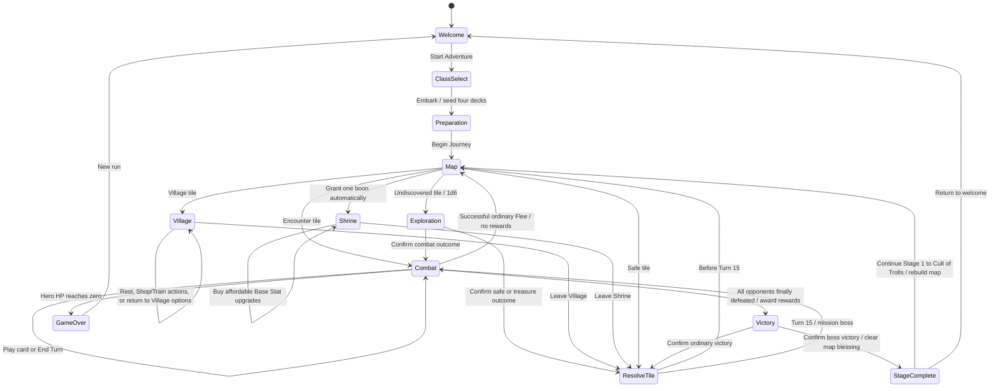

# System Architecture — The Paths We Choose

## Runtime and boundaries

Strict TypeScript, Vite, DOM and CSS form the current web application. There is no installed Capacitor wrapper or native build pipeline. Run persistence is not implemented. Browser APIs belong outside `src/core/`.

- `src/core/types.ts`: canonical TypeScript contracts; reference this file rather than maintaining a second schema copy.
- `src/core/rng.ts`: seeded PRNG, shuffles, 1d6 and 2d6 rolls. The retained d20 helper is not the combat hit system.
- `src/core/stats.ts`: six effective attributes, derived values, quadratic SP prices, equipment previews and vital synchronization.
- `src/core/deck.ts`: Adventure, Monster, Treasure and Combat deck operations.
- `src/core/combat.ts`: attack checks, card resolution, enemy patterns and abilities. Core log timestamps are explicit inputs, not wall-clock reads.
- `src/core/shrine.ts`: automatic eligible boon selection, replacement and map expiry. Compatibility prayer APIs remain but are not the current player flow.
- `src/core/village.ts`: Rest, Shop stock, buying/selling, equipment, consumables and Train.
- `src/core/engine.ts`: run start, preparation, movement, exploration, encounter outcomes, boss victory and mission continuation.
- `src/data/`: declarative content. [CATALOGS.md](CATALOGS.md) is generated from these modules.
- `src/state/store.ts`: in-memory pub/sub and application clock boundary; not a save adapter.
- `src/main.ts`: browser bootstrap, run-seed creation, event delegation and UI dispatch.
- `src/ui/`: DOM string rendering, incremental carousel updates, art/icon helpers and responsive CSS.
- `src/audio/audioManager.ts`: HTML audio and gesture unlock. `src/core/audio.ts` determines the track without browser APIs.
- `src/updates.ts`: production release polling and player-controlled reload.
- `src/tests/`: core, deck, audio, rendering, release-check and individual-creature coverage. Use `npm test` for current suite totals.

## Determinism

The application supplies a seed and an optional `RunState.logTimestamp` formatted HH:MM:SS. Store transitions stamp this field using an injectable clock outside core. Combat session creation receives the timestamp explicitly; direct core callers without it use 00:00:00. With identical state, seed and observational inputs, logs and gameplay output replay identically. The clock never changes RNG outcomes. Failed/no-op store transitions preserve the existing state reference and do not publish an update.

All game rules remain in core. Catalog tables are generated with `npm run docs:sync`; production builds run `npm run docs:check` and fail if the tables drift.

## Reusable deck panels

`deckPilesPanelHtml` in `src/ui/render.ts` is the single deck/discard widget for every screen. Its configuration selects `visibleGroups`, heading, labels, footer visibility, and an optional CSS class. The map uses all groups; the combat-log sidebar uses only the live Action Draw and Action Discard piles immediately above the battle log. Both use the same `open-pile` action and `pileModal`, so players can inspect the grouped contents and copy counts from either location. A one-group panel also assigns its whole panel a default draw-pile target for right-click inspection; its Discard card remains a distinct target.

## State machine

`screen` is welcome, class_select or play_area. `activeHook` controls overlays; preparation uses `welcomePreparing` on play_area.

Flee is disabled for bosses. The current public continuation is Stage 1 to Stage 2; the diagram is not a claim of a third mission. Stage continuation preserves character progression and inventories while creating the next 30-card map.

## Formula and flow invariants

- Effective attribute = Base + Class + Blessing + Equipped Gear.
- Upgrading Base B to B+1 costs `(B+1)^2` SP, only during initial preparation or at a Shrine. No character level or XP exists.
- ACC = floor(DEX/2) + gear ACC, plus card and temporary accuracy modifiers. Iron Sword + currently grants +1 direct ACC; DEX equipment affects the base calculation.
- EVA = floor(AGI/2) + gear EVA + temporary EVA.
- ATK = floor(STR/2) + floor(DEX/3) + gear ATK; DEF = floor(STR/5) + floor(AGI/3) + gear DEF.
- MATK = floor(INT/2) + gear MATK; MDEF = floor(INT/5) + gear MDEF; maximum AP = 3 + floor(INT/5).
- Critical damage = floor(pre-mitigation damage × 1.5), with no extra minimum damage rule. Snake eyes always misses. Card scaling and passives are specified in MECHANICS_AND_DATA.md.
- One eligible shrine boon is granted on arrival. A new blessing replaces the old one; map favors clear upon acknowledging boss victory. No manual three-option choice is needed.
- Village Rest uses selectable one-Gold ticks that heal 2 HP (the final **Full** tick heals the remainder). Rest is disabled at full HP and does not cleanse statuses.
- Village entry pre-draws Shop and Train inventories. Shop/Train always return to the main menu without rerolls; services remain available until the player leaves.

## Four-deck conservation and ownership

These equations count ownership, not UI references. They apply to nonterminal ordinary gameplay transitions, not arbitrary test fixtures or manually inserted cards. GameOver replaces the active combat hook and does not retain its encounter cards; do not apply the live monster equation to that terminal snapshot.

1. Adventure: draw pile + discard + board adventure cards = 30. Exclude the separately created Start Tile. At Turn 0, five adventure cards are on the board, 25 remain in the deck, and discard is empty. Starting the next mission replaces the previous map and deck.
2. Monsters: draw pile + monsterDiscard + all non-boss cards owned by an active COMBAT encounter = 38. Count both living and defeated participants until encounter resolution; exclude separately spawned bosses. Victory showcase references point to cards already returned to discard, so do not count them twice. Leech moves an existing Zombie from discard to encounter; Creeper revives its own instance without creating a card.
3. Player Combat: during combat, draw pile + hand + discard + `inPlay` = playerMasterDeck length. The master deck is a definition list, not additional owned copies. Battle-long enchantments occupy `inPlay` until destroyed or combat ends; the permanent Flee action is not in any of these piles. Village Train can change master-deck length.
4. New Skills: `newSkillsDeck` + `newSkillsDiscard` + active Village `trainOptions` + learned non-starter cards in `playerMasterDeck` equals two copies of every trainable non-starter class skill. Starter cards are created only in the initial 8/2 starter deck. Void upgrade templates, Boss cards, and unselected hero cards are explicitly excluded: the Void is a derived, inexhaustible public catalog rather than a physical deck.
5. Treasure: draw pile + treasureDiscard + current village shopStock + backpack items + equipped items = 42 minus consumed item copies. Purchases and sales transfer existing copies; unbought stock is discarded on village exit. Consuming a potion removes its physical copy from circulation. UI previews and exploration found-item references are not additional copies.

Spell/ability searches use one bounded current-deck pass and return null/fizzled on failure; they recycle only if the search starts empty. Encounter generation instead recycles during the mechanic whenever another draw needs an empty deck and eligible graveyard supply remains. Terrain rejects stay on the bottom and are examined only once per pass; a full pass with only incompatible terrain cards stops without accessing a nonempty deck's graveyard. If the budget cannot be filled, existing draws still fight; an empty encounter resolves without rewards and retains the Turn 15 boss check. This is unavailable eligible supply, not ability fizzle. Ordinary fixed-count draws recycle normally. See MECHANICS_AND_DATA.md for exact search boundaries and public graveyard/hidden deck-order rules.

## Audio states

Welcome loops start-screen. Class selection and play_area/NONE use map-area. COMBAT uses battle-normal. Village, Shrine, Exploration, Victory, GameOver and StageComplete are silent. HTML audio ownership, mute/volume and autoplay unlock remain in AudioManager; scene selection remains pure in core/audio.ts.

## Cloudflare releases and cache freshness

Deploy the complete `dist/` directory from `npm run build` atomically, using Cloudflare Pages or Workers Static Assets. `public/_headers` is copied to `dist/_headers` and requires browser revalidation for every static URL, including HTML, artwork, icons, audio, and `version.json`. This deliberately uses one conservative policy: browsers can retain bytes and reuse them after a 304 response, but cannot keep serving stale files without checking. Vite continues to hash JS/CSS filenames. Do not override this policy with a longer Browser Cache TTL or Cache Everything rule for HTML or the manifest. Workers/Functions that generate responses must set equivalent headers themselves; `_headers` applies to static asset responses.

Every production build generates a unique build ID embedded in the client and emitted in `version.json`. The browser checks this manifest on startup, every minute while visible, and when returning to the tab, with `cache: no-store` and a ten-second timeout. Any different valid build ID (including rollback) displays a persistent update notice outside the game renderer. Failed/offline checks are silent and retried later. Development mode does not poll.

The player chooses **Reload to update**. The game never reloads an adventure automatically. Because run persistence is not implemented, reloading during play asks for confirmation and explains that the adventure will be lost. Existing tabs continue running their loaded rules until reload; fixed-URL media revalidates on subsequent requests. There is no service worker or offline cache to invalidate.

Release verification on the deployed domain: confirm `/`, `/version.json`, and an artwork/audio URL return `Cache-Control: public, max-age=0, must-revalidate`; deploy a second build while an old tab stays open, confirm the notice appears within a minute or on tab return, and confirm reload loads the new build. Also verify cancellation preserves an active run and rolling back shows an update notice. Vite preview does not interpret Cloudflare `_headers`, so response headers require verification on Cloudflare before launch.

## Treasure level filtering and recycling

Village stock accepts only `item.level === village.level`. Wrong-level items, both lower and higher, go immediately to treasureDiscard and do not count toward the `5 + village level` stock target. Draw again until the target is filled, reshuffling the treasure graveyard whenever a further draw needs an empty deck.

Undiscovered terrain rewards use `item.level <= terrain.level` as a cap. A Level 2 Forest discovery accepts Level 1 or Level 2 items. If the last card is an invalid Level 3 item, discard it, reshuffle the treasure graveyard into the new deck, and continue drawing until a valid reward appears. This is a game mechanic, not a spell/attack fizzle. Starting with an empty Treasure Deck follows the same reshuffle rule.

Eligible physical copies are conserved; nothing is created to fill stock. If no matching supply exists anywhere in the deck/graveyard (for example no Level 5 items are currently defined, or all matching copies are already owned), stop safely with empty/partial stock or no reward rather than loop forever. This is unavailable supply, not ability failure. A village's stock is generated only once per visit, including empty stock; returning to its menu does not reroll it. The current item catalog has Levels 1–4; Level 3 and 4 stock can be partial when matching physical copies are scarce.
