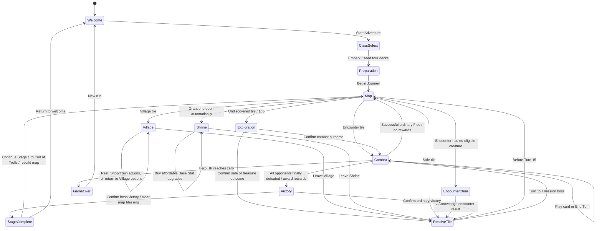

# System Architecture — The Paths We Choose

## Runtime and boundaries

Strict TypeScript, Vite, DOM and CSS form the current web application. There is no installed Capacitor wrapper or native build pipeline. Run persistence is not implemented. Browser APIs belong outside `src/core/`.

- `src/core/types.ts`: canonical TypeScript contracts; reference this file rather than maintaining a second schema copy.
- `src/core/rng.ts`: seeded PRNG, shuffles, 1d6 and 2d6 rolls. The retained d20 helper is not the combat hit system.
- `src/core/stats.ts`: six effective attributes, derived values, quadratic SP prices, equipment previews and vital synchronization.
- `src/core/deck.ts`: Adventure, Monster, Treasure and Combat deck operations.
- `src/core/combat.ts`: attack checks, card resolution, enemy patterns and abilities. Core log timestamps are explicit inputs, not wall-clock reads.
- `src/core/shrine.ts`: automatic eligible boon selection, replacement and map expiry. Compatibility prayer APIs remain but are not the current player flow.
- `src/core/village.ts`: Rest, Shop stock, buying/selling, equipment, consumables and Train.
- `src/core/engine.ts`: run start, preparation, movement, exploration, encounter outcomes, boss victory and mission continuation.
- `src/data/`: declarative content. [CATALOGS.md](CATALOGS.md) is generated from these modules.
- `src/state/store.ts`: in-memory pub/sub and application clock boundary; not a save adapter.
- `src/main.ts`: browser bootstrap, run-seed creation, event delegation and UI dispatch.
- `src/ui/render.ts`: screen composition, modal composition and incremental carousel updates.
- `src/ui/actionCard.ts`: the canonical Action card face, live effect text and shared action-effect calculation used by hands, decks, training, confirmations and inspection.
- `src/ui/adventureCard.ts` and `src/ui/terrainPresentation.ts`: the canonical compact Land card and the single terrain label/icon/set/CSS mapping used by map, pile and event views.
- `src/ui/grouping.ts`: stable one-pass repeated-card grouping used by every pile viewer.
- `src/ui/brand.ts` and `src/ui/publicAsset.ts`: canonical Morville Studios brand presentation and deployment-base-aware public asset URLs.
- `src/ui/cardArt.ts`, `src/ui/icons.ts` and `src/ui/styles.css`: art lookup, icon helpers and responsive presentation.
- `src/audio/audioManager.ts`: HTML audio and gesture unlock. `src/core/audio.ts` determines the track without browser APIs.
- `src/updates.ts`: production release polling and player-controlled reload.
- `src/i18n/`: browser language selection, saved player preference, bundled translations, and presentation-only translation. English catalog values and state identifiers remain canonical so switching languages during a run never changes rules or random outcomes.
- `src/tests/`: core, deck, audio, rendering, release-check and individual-creature coverage. Use `npm test` for current suite totals.

## Determinism

The application supplies a seed and an optional `RunState.logTimestamp` formatted HH:MM:SS. Store transitions stamp this field using an injectable clock outside core. Combat session creation receives the timestamp explicitly; direct core callers without it use 00:00:00. With identical state, seed and observational inputs, logs and gameplay output replay identically. The clock never changes RNG outcomes. Failed/no-op store transitions preserve the existing state reference and do not publish an update.

All game rules remain in core. Catalog tables are generated with `npm run docs:sync`; production builds run `npm run docs:check` and fail if the tables drift.

## Localization

The web game offers English, Traditional Chinese, Simplified Chinese, Japanese, and Korean. An explicit `?lang=` choice takes precedence over the saved preference, then the browser's ordered languages; unsupported languages fall back to English. The player can change language while playing. The UI rebuilds from the same `RunState` and translates presentation text and accessibility labels, including card catalog text and handbook content. Localization must stay outside `src/core/`; core logs and card identifiers remain deterministic English source data. Bundled locale data is generated during authoring and requires no translation network call from a player's browser.

## Component-based frontend architecture (Native ES6+ & Zero Framework Runtime)

The application does **not use React, Vue, or any external UI framework runtime**. Instead, it implements a modern **Pure Functional Component & Unidirectional Data Flow pattern** built directly on native ECMAScript 6+ standards and strict TypeScript:

1. **Pure Functional UI Components**:
   - Every UI element is an exported, pure TypeScript function that accepts typed state/props and returns a declarative HTML string using native **ES6 Template Literals** (e.g. `` `${val}` ``):
     - `playerInfoWidgetHtml(state, config)`: Reusable Character & Gear panel (composed across Map sidebar, Shrine modal, and Turn 0 preparation dialog).
     - `villageViewHtml(state, village, ui)`: In-place village component replacing the adventure board in `.play-main`.
     - `deckPilesPanelHtml(state, config)`: Unified deck/discard piles viewer (reused in full on the map and sharded in combat).
     - `turnTrackerHtml(state)`: Tabletop physical boardgame turn tracker strip.
     - `renderActionCardHtml`, `fullCreatureCardHtml`, `renderAdventureCardHtml`: Physical TCG card visual components.
2. **Why Native JS/TS Components Over Frameworks?**:
   - **Zero Runtime Overhead**: 0 KB framework baggage ensures lightning-fast startup and instant First Contentful Paint (FCP).
   - **Deterministic & Lightweight Testing**: Components can be unit-tested with standard string assertions without complex test harnesses, virtual DOM shims, or JSDOM ceremony.
   - **Capacitor & Mobile Webview Optimization**: No virtual DOM reconciliation cycles or memory leak hazards on low-end iOS/Android devices.
   - **Standard Longevity**: Built on standard ECMAScript template literals and DOM APIs that will run identically years from now without framework churn.
3. **Unidirectional Data Flow**:
   - State is held immutably in a single store (`RunState`). User interactions trigger top-level **Event Delegation** via `data-action` attributes in `src/main.ts`. Handlers invoke pure core transitions in `src/core/`, which return a new `RunState` and trigger a top-level render re-evaluation.
4. **Targeted In-Place DOM Transitions**:
   - High-frequency animations (such as the 3D Adventurer class carousel and Monster carousel) use targeted in-place DOM updates (`updateClassCarouselDom`, `updateMonsterCarouselDom`) to modify classes and transform styles without destroying nodes, preserving hardware-accelerated CSS transitions.

## Data-oriented deck modeling vs. mutable OOP classes

In tabletop game development, decks and cards are often conceived in classical OOP terms (`class Deck { shuffle() { this.cards.sort(...) } }`). Our architecture deliberately adopts a **Data-Oriented and Functional pattern** instead:

1. **Decks as Plain Typed Arrays (`T[]`)**:
   - Every card pile in `RunState`—`adventureDeck`, `monsterDeck`, `playerMasterDeck`, `treasureDeck`, `newSkillsDeck`, and the physical `monsterVoid`—is a plain, typed JavaScript array (`T[]`).
2. **Pure Deterministic Operations**:
   - Operations like `shuffleArray(array, rngState)` take array inputs and a numeric PRNG seed, returning `{ shuffled: T[], nextState: number }` without in-place mutation.
   - **100% Seeded Replayability**: Given the same seed, any adventure, card draft, or combat hit check reproduces identically on every platform.
3. **Frictionless Serialization (Save / Load)**:
   - Because all state objects are plain data structures without class methods or hidden prototype closures, saving and restoring the entire game state is standard `JSON.stringify(state)` and `JSON.parse(string)`.
4. **Uniform Pile Abstraction (`PileType`)**:
   - Decks, graveyards, and the Void share a unified `PileType` union (`'adventure_deck' | 'monster_deck' | 'void_deck' | ...`), allowing generic components like `deckPilesPanelHtml` and `pileModal` to inspect and display any card collection uniformly.

## Composition over inheritance

1. **Type & Data Level**:
   - TypeScript interface inheritance is used extensively (`interface CombatCardDef extends BaseCard`) to share data contracts while enforcing strict compilation safety.
2. **UI & Presentation Level**:
   - Visual components avoid rigid class inheritance hierarchies (`class Card extends BaseUIComponent`), employing **Functional Composition** instead. Highly customizable base templates (`baseCardHtml`, `deckPilesPanelHtml`, `playerInfoWidgetHtml`) are composed and configured with props and slots to create specialized card faces, modals, and screen sections.

## Reusable deck panels

`deckPilesPanelHtml` in `src/ui/render.ts` is the single deck/discard widget for every screen. Its configuration selects `visibleGroups`, heading, labels, footer visibility, and an optional CSS class. The map uses all groups; the combat-log sidebar uses only the live Action Draw and Action Discard piles immediately above the battle log. Both use the same `open-pile` action and `pileModal`, so players can inspect the grouped contents and copy counts from either location. A one-group panel also assigns its whole panel a default draw-pile target for right-click inspection; its Discard card remains a distinct target.

## Reusable card presentation

Full Action cards are rendered only by `renderActionCardHtml`; callers supply interaction, mini/full scale and inspection classes through typed options. `getActionCardText` and `getActionCardEffect` are shared by every Action-card context, preventing deck, confirmation and inspection faces from drifting. Compact Land cards are rendered only by `renderAdventureCardHtml`; map nodes, pile viewers and event modals configure the same template. Terrain labels, plural labels, icons, set codes, badge classes and frame classes come from `getTerrainPresentation` rather than screen-specific conditionals. Creature full cards continue to use `fullCreatureCardHtml`, and item full cards use `renderTcgItemCard`.

Pile viewers use the generic `groupByCount` helper. It groups each physical pile in one stable pass, after which the screen applies its card-type-specific sort and renderer. Adventure-order lookups use a precomputed card-number index rather than repeated linear searches inside the sort comparator.

## Modal stack and input ownership

Preparation, combat, confirmation, shrine, exploration, victory, guide, and informational overlays can be nested (Village operates as an in-place view component replacing the board in `.play-main`, keeping Character & Gear and Decks sidebars active without a modal backdrop). Card, stat, and pile inspection backdrops use the shared `inspection-backdrop` layer above every gameplay view, so an inspection cannot open invisibly behind the active hook. While an inspection, pile viewer, guide, card confirmation, or flee confirmation is open, carousel keyboard and swipe input do not reach gameplay underneath it. Escape closes the topmost informational layer first, revealing any underlying confirmation or gameplay view without leaving queued inspection state.

## State machine

`screen` is welcome, class_select or play_area. `activeHook` controls overlays; preparation uses `welcomePreparing` on play_area.

Flee is disabled for bosses. The current public continuation is Stage 1 to Stage 2; the diagram is not a claim of a third mission. Stage continuation preserves character progression and inventories while creating the next 30-card map.

## Formula and flow invariants

- Effective attribute = 1 (Innate) + Base + Class + Blessing + Equipped Gear. Every attribute receives an innate +1 baseline so leveling Base from 1 to 2 scales effective power smoothly (2 -> 3, a +50% progression rather than a jarring 100% jump).
- Upgrading Base B to B+1 costs `(B+1)^2` SP, only during initial preparation or at a Shrine. A Shrine caps the target Base at Shrine Level + 1; Turn 0 preparation has no Shrine-level cap. No character level or XP exists.
- ACC = floor(DEX/2) + gear ACC, plus card and temporary accuracy modifiers. Iron Sword + currently grants +1 direct ACC; DEX equipment affects the base calculation.
- EVA = floor(AGI/2) + gear EVA + temporary EVA.
- ATK = floor(STR/2) + floor(DEX/3) + gear ATK; DEF = floor(STR/5) + floor(VIT/5) + floor(AGI/3) + gear DEF; Max HP = 10 + Effective VIT * 2.
- MATK = floor(INT/2) + gear MATK; MDEF = floor(INT/5) + gear MDEF; maximum AP = 3 + floor(INT/5).
- Critical damage = floor(pre-mitigation damage × 1.5), with no extra minimum damage rule. Snake eyes always misses. Card scaling and passives are specified in MECHANICS_AND_DATA.md.
- One eligible shrine boon is granted on arrival. A new blessing replaces the old one; map favors clear upon acknowledging boss victory. The Shrine overlay shows the stepped-on card/lore and reuses the same `playerInfoWidgetHtml` component as the Map. Stat choice is transient UI state: selecting never mutates the run, unaffordable choices show missing SP, and confirmed Upgrade/Leave actions alone invoke core transitions. No manual three-option prayer choice is needed.
- Village Rest uses selectable one-Gold ticks that heal 2 HP (the final **Full** tick heals the remainder). Rest is disabled at full HP and does not cleanse statuses.
- Village entry pre-draws Shop and Train inventories. Shop/Train always return to the main menu without rerolls; services remain available until the player leaves. Training shows current Gold/SP in a dedicated sidebar and requires confirmation before learning or destroying a card.

## Unified Adventure Chronicle (Game Log) & In-Place Battle Component

1. **In-Place Battle Component (Zero Full-Screen Dialog Overkill)**:
   - Rather than popping up a modal dialog that dims the viewport and re-renders duplicate copies of the hero's vitals, stats, backpack, and action piles, combat renders directly as an in-place component view in `.play-main` (swapping out the board map, mirroring the Village component pattern).
   - The main 3-column dashboard layout remains active and stable:
     - **Left Sidebar (`.play-sidebar` / `.is-combat-hero`)**: Renders the canonical `combatHeroSidebarHtml` containing live Hero HP, Block indicator, active hexes/status debuffs, core 6 attributes, derived combat chips (DEF, ATK, ACC, EVA), and backpack with usable consumables (e.g. Health Potions).
     - **Center Column (`.play-main` / `.is-combat-main`)**: Houses `combatViewHtml`, containing the 3D monster carousel, intent/HP dock, 2d6 dice outcome banner, player vitals line, combat hand carousel, in-play enchantments, and Flee & End Turn action buttons.
     - **Right Sidebar (`.play-sidebar-right` / `.is-combat-right`)**: Displays `combatRightSidebarHtml`, presenting the Action Deck draw and discard piles alongside the live stream of the Battle Log.
   - The top HUD remains intact, showing the official game logo, Scenario, Hero Class, Divine Protection, and the boardgame Turn Tracker (1 to 15). Gold and SP are placed in the Character sidebar above the health bar.

2. **Unified Single-Log Chronicle (`state.gameLog`)**:
   - The entire run is chronicled in a single, continuous, ordered array of log entries (`state.gameLog`).
   - Every significant adventure event is recorded with an explicit boundary timestamp `[HH:MM:SS]` and semantic category icon:
     - **Journey & Map**: Initial embarkation, deal of 9 starting Adventure cards, path selection (`🗺️ Turn X: Chose path...`), and new lookahead deals (`🎴 Dealt 3 Adventure cards to the horizon...`).
     - **Wilderness Exploration**: Undiscovered terrain 1d6 dice rolls, creature ambushes, and discovered treasure items.
     - **Village Life**: Arriving at villages, resting at the inn (HP restored & Gold spent), buying/selling gear, equipping/unequipping items, learning skills from trainers, and purging cards to the Void.
     - **Sacred Shrines**: Divine boons granted and Base Stat upgrades purchased with Stat Points.
     - **Combat & Battle**: Encounter start, Action card draws each round, cards played, 3d6 MACG-3D6™ hit/miss dice rolls, damage dealt, Hero natural DEF absorption, divine protection reductions, shield blocks, applied hexes/debuffs, life drains, monster defeats, combat victory rewards (+SP and +Gold), and flee attempts.
   - Players can review the entire adventure history at any moment by clicking the HUD `📜 Log (N)` button, clicking `View All` in the Game Log widget below the main viewport, or pressing `L` on the keyboard, opening the dedicated full-page **Adventure Chronicle** modal (`gameLogModal`).

## Four-deck conservation and ownership

These equations count ownership, not UI references. They apply to nonterminal ordinary gameplay transitions, not arbitrary test fixtures or manually inserted cards. GameOver replaces the active combat hook and does not retain its encounter cards; do not apply the live monster equation to that terminal snapshot.

1. Adventure: draw pile + discard + board adventure cards = 30. Exclude the separately created Start Tile. At Turn 0, five adventure cards are on the board, 25 remain in the deck, and discard is empty. Starting the next mission replaces the previous map and deck.
2. Monsters: monsterDeck + monsterDiscard + monsterVoid + all non-boss cards owned by an active COMBAT encounter = 76. Scenario setup partitions the complete physical supply between Monster Deck and Void using rarity/main-terrain rules. Count both living and defeated participants until encounter resolution; exclude separately spawned bosses. Victory showcase references point to cards already returned to discard, so do not count them twice. Leech moves an existing Zombie from discard to encounter; Creeper revives its own instance without creating a card.
3. Player Combat: during combat, draw pile + hand + discard + resolving `stack` + `inPlay` = playerMasterDeck length. The master deck is a definition list, not additional owned copies. A played card remains on the Stack until all costs, draws, AP gains and triggered effects finish; only then does it enter discard or `inPlay`. Battle-long enchantments occupy `inPlay` until destroyed or combat ends; the permanent Flee action is not in any of these piles. Village Train can change master-deck length.
4. New Skills: `newSkillsDeck` + `newSkillsDiscard` + active Village `trainOptions` + learned non-starter cards in `playerMasterDeck` + destroyed learnable cards in `voidCards` equals two copies of every trainable non-starter class skill. Starter cards are created only in the initial 8/2 starter deck. Static Void upgrade templates, Boss cards, and unselected hero cards are inexhaustible catalog entries; cards destroyed during Training and ordinary cards in `monsterVoid` are physical Void cards.
5. Treasure: draw pile + treasureDiscard + current village shopStock + backpack items + equipped items = 42 minus consumed item copies. Purchases and sales transfer existing copies; unbought stock is discarded on village exit. Consuming a potion removes its physical copy from circulation. UI previews and exploration found-item references are not additional copies.

Spell/ability searches use one bounded current-deck pass and return null/fizzled on failure; they recycle only if the search starts empty. Encounter generation instead recycles during the mechanic whenever another draw needs an empty deck and eligible graveyard supply remains. Terrain rejects stay on the bottom and are examined only once per pass; a full pass with only incompatible terrain cards stops without accessing a nonempty deck's graveyard. If the budget cannot be filled, existing draws still fight; an empty encounter enters `ENCOUNTER_CLEAR`, shows the encounter result for acknowledgement, awards no rewards, then retains the Turn 15 boss check. This is unavailable eligible supply, not ability fizzle. Ordinary fixed-count draws recycle normally. See MECHANICS_AND_DATA.md for exact search boundaries and public graveyard/hidden deck-order rules.

## Audio states

Welcome loops start-screen. Class selection and play_area/NONE use map-area. COMBAT uses battle-normal. VICTORY plays victory.mp3 while rewards are displayed, and fades/stops upon exiting the victory dialog. Village, Shrine, Exploration, EncounterClear, GameOver and StageComplete are silent. HTML audio ownership, mute/volume and autoplay unlock remain in AudioManager; scene selection remains pure in core/audio.ts.

## Cloudflare releases and cache freshness

Deploy the complete `dist/` directory from `npm run build` atomically beneath `/games/the-paths-we-choose/`, using Cloudflare Pages or Workers Static Assets. Runtime public assets use `publicAsset()` and Vite's relative base, so they remain inside that route instead of leaking to domain-root `/cards`, `/icons`, or `/audio` paths. `public/_headers` is copied to `dist/_headers`: `index.html` and `version.json` use no-cache/no-store revalidation, content-fingerprinted Vite bundles under `assets/` cache immutably for one year, fixed-name public media uses the fallback `max-age=0, must-revalidate`, and social previews use a bounded one-day cache with stale-while-revalidate. Do not apply Cache Everything to HTML or the release manifest. Workers/Functions that generate responses must set equivalent headers themselves; `_headers` applies to static asset responses.

Every production build generates a unique build ID embedded in the client and emitted in `version.json`. The browser checks this manifest on startup, every minute while visible, and when returning to the tab, with `cache: no-store` and a ten-second timeout. Any different valid build ID (including rollback) displays a persistent update notice outside the game renderer. Failed/offline checks are silent and retried later. Development mode does not poll.

The player chooses **Reload to update**. The game never reloads an adventure automatically. Because run persistence is not implemented, reloading during play asks for confirmation and explains that the adventure will be lost. Existing tabs continue running their loaded rules until reload; fixed-URL media revalidates on subsequent requests. There is no service worker or offline cache to invalidate.

Release verification on the deployed domain: confirm the canonical game document and `version.json` do not cache, a hashed `assets/` bundle is immutable, and a fixed artwork/audio URL returns `Cache-Control: public, max-age=0, must-revalidate`; deploy a second build while an old tab stays open, confirm the notice appears within a minute or on tab return, and confirm reload loads the new build. Also verify cancellation preserves an active run and rolling back shows an update notice. Vite preview does not interpret Cloudflare `_headers`, so response headers require verification on Cloudflare before launch. See `BRANDING_AND_SEO.md` for the shared-domain sitemap and portfolio contract.

## Treasure level filtering and recycling

Village stock accepts the Village level and one level below it: `max(1, village.level - 1) <= item.level <= village.level`. A Level 1 store therefore accepts only Level 1; Level 2 accepts Levels 1–2; Level 3 accepts Levels 2–3. Other levels go immediately to treasureDiscard and do not count toward the `5 + village level` stock target. Draw again until the target is filled, reshuffling the treasure graveyard whenever a further draw needs an empty deck.

Undiscovered terrain rewards use `item.level <= terrain.level` as a cap. A Level 2 Forest discovery accepts Level 1 or Level 2 items. If the last card is an invalid Level 3 item, discard it, reshuffle the treasure graveyard into the new deck, and continue drawing until a valid reward appears. This is a game mechanic, not a spell/attack fizzle. Starting with an empty Treasure Deck follows the same reshuffle rule.

Eligible physical copies are conserved; nothing is created to fill stock. If no matching supply exists anywhere in the deck/graveyard (for example no Level 5 items are currently defined, or all matching copies are already owned), stop safely with empty/partial stock or no reward rather than loop forever. This is unavailable supply, not ability failure. A village's stock is generated only once per visit, including empty stock; returning to its menu does not reroll it. The current item catalog has Levels 1–4; Level 3 and 4 stock can be partial when matching physical copies are scarce.
